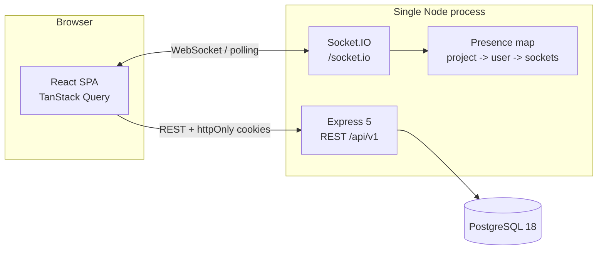

# TeamBoard

**Project management, minus the chaos.** An internship-level, small-team project management app
in the spirit of Trello and Asana: projects, a Kanban board, task assignment, comments, in-app
notifications, and live updates over WebSockets.


## What it does and why

TeamBoard is a complete, runnable reference app for a small team: create a project, invite
registered teammates, move work across three default columns, discuss tasks in a drawer, and see
the board update in other browsers without a refresh. It is deliberately a **modular monolith**:
one Node process, one PostgreSQL database, and no infrastructure the reviewer has to install
beyond Docker.

The build followed eight strictly ordered phases with tests at every boundary. The design is the
source of truth: [design document](docs/superpowers/specs/2026-11-01-teamboard-design.md).

## Demo accounts

Seeded by `npm run setup` / `npm run db:seed`. All three use the password `Password123!`:

| Email                | Role in the demo data                                      |
| -------------------- | ---------------------------------------------------------- |
| `maya@teamboard.dev` | Owner of _Website Redesign_ and _Mobile App Launch_        |
| `dev@teamboard.dev`  | Member on both projects, assignee on several tasks         |
| `sam@teamboard.dev`  | Admin on _Website Redesign_, member on _Mobile App Launch_ |

## Features

**Accounts and projects**

- Cookie-based authentication with 15-minute access tokens and rotating 7-day refresh sessions
  (reuse detection revokes the session family).
- Login/register with inline validation and a demo-account shortcut; protected routes with return
  paths.
- Project CRUD, owner/admin/member roles, member search and invitation by email, leave/remove,
  and a typed-name delete confirmation.

**Board and tasks**

- One board per project with three default columns, owner/admin column management, and reordering.
- Task CRUD, priority, due date, single assignee, and a task drawer (`?task=<id>` deep link).
- Drag-and-drop with pointer and keyboard sensors, optimistic moves with rollback and toast, and
  server-computed ordering (fractional positions with renumbering).

**Comments and notifications**

- Flat task comments, oldest-first, capped at 200, with author edits and author/admin/owner deletes.
- Optimistic comment posting with rollback.
- Assignment and comment notifications created in the same transaction as the task/comment write,
  with dedupe, self-action, and membership filtering.
- Bell popover with an unread badge, mark-one/mark-all, cursor pagination, and deep links into the
  task drawer.
- Notification polling falls back to REST while the socket is disconnected.

**Realtime and quality**

- Authenticated Socket.IO project rooms, membership-checked joins, ref-counted multi-tab presence,
  and post-commit events for every task, column, comment, project, member, and notification change.
- Teardown on member removal/project deletion, reconnect + automatic room rejoin, and cache
  invalidation as the client synchronization strategy.
- Route-level not-found/forbidden/error states, an error boundary, skeletons, empty states, retries,
  a skip-to-content link, and responsive layouts from 375px up.
- API integration tests against real PostgreSQL, socket integration tests with real cookies, and a
  two-user Playwright smoke suite.

## Stack

| Layer     | Technology (pinned)                                                                 |
| --------- | ----------------------------------------------------------------------------------- |
| Runtime   | Node 24 LTS, TypeScript 6.0.2, npm workspaces                                       |
| Server    | Express 5.3.0, Drizzle ORM 0.45.4 / drizzle-kit 0.31.11, pg 8.23.1, Socket.IO 4.8.4 |
| Database  | PostgreSQL 18 via Docker Compose                                                    |
| Client    | React 19.3.1, Vite 8.3.5, React Router 7.18.5, TanStack Query 5.105.0               |
| UI        | Tailwind CSS 4.3.3, shadcn/ui 4.23.0 on **Base UI** 1.9.0 (no Radix), sonner        |
| Contracts | Zod 4.6.7 in `packages/shared`                                                      |
| Testing   | Vitest 5.0.5, Testing Library, Supertest, Playwright 1.64.1                         |

No Redis, queues, microservices, background workers, or a second board per project.

## Architecture



- `apps/server` owns the REST API, Socket.IO server, Drizzle schema/migrations, and the seed.
- `apps/client` is the Vite + React SPA. It never imports server code.
- `packages/shared` holds Zod request schemas, DTOs, constants, and the typed realtime event map.
- Services emit realtime events **after** their database transaction commits. `getIo()` is nullable,
  so REST-only tests and runs without Socket.IO stay safe.
- The Vite dev server proxies `/api` and `/socket.io`, so development and production are same-origin.

## Quick start

Prerequisites: Node.js 24 LTS (`nvm use` reads `.nvmrc`) and Docker with Compose.

```bash
npm install     # install workspaces
npm run setup   # .env (if missing), PostgreSQL, migrations, seed — safe to re-run
npm run dev     # API on :4000, client on :5173
```

Open <http://localhost:5173> and use **Use demo account** on the login screen. The Vite dev server
proxies `/api` and `/socket.io` to the API, so cookies and sockets behave like production.

Production shape (one origin, Express serves the built SPA):

```bash
npm run build
npm start       # serves dist/server.js; set SERVE_CLIENT=true and production env vars
```

## Scripts

| Script                            | Purpose                                                 |
| --------------------------------- | ------------------------------------------------------- |
| `npm run setup`                   | Idempotent bootstrap: `.env`, database, migrate, seed   |
| `npm run dev`                     | Server and client together (concurrently)               |
| `npm run start`                   | Run the built server (`dist/server.js`)                 |
| `npm run build`                   | Bundle the server and build the SPA                     |
| `npm run db:up` / `db:down`       | Start/stop PostgreSQL via Docker Compose                |
| `npm run db:generate`             | Generate a migration from schema changes                |
| `npm run db:migrate`              | Apply migrations                                        |
| `npm run db:seed`                 | Idempotent demo data                                    |
| `npm run db:reset`                | Destructive: drop schema, migrate, seed                 |
| `npm run lint` / `npm run format` | ESLint / Prettier (`format:check` verifies)             |
| `npm run typecheck`               | TypeScript across every workspace                       |
| `npm test`                        | Unit and API/socket integration tests (real PostgreSQL) |
| `npm run test:e2e`                | Build, reset/seed the test DB, run the Playwright smoke |
| `npm run test:e2e:ui`             | Playwright UI mode                                      |
| `npm run screenshots`             | Rebuild and capture `docs/screenshots/` from the seed   |

## Testing

The API integration suite is the backbone and runs against a dedicated `teamboard_test`
database, never the development database. Socket tests boot a real HTTP server on an ephemeral
port, connect with real access cookies, and assert auth, room isolation, presence ref counts,
payloads, and teardown.

```bash
npm test                                     # all workspaces
npm test -w @teamboard/server                # API + socket integration
npm test -w @teamboard/client                # component tests
npm run test:e2e                             # two-user Playwright smoke
```

Rules that keep the suites deterministic:

- `NODE_ENV=test` must use `TEST_DATABASE_URL`; a missing value fails loudly.
- Integration files run serially and truncate tables before each test.
- Sockets are closed and presence is reset after every socket test.
- E2E uses `teamboard_test` (reset + seeded by `test:e2e:prepare`), never your dev data.
- Rate limits are disabled under tests except where a dedicated app exercises them.

## API and realtime

35 REST endpoints under `/api/v1`: auth/users (7), projects/members (9), columns (4), tasks (6),
comments (4), notifications (4), and health (1). Every request body, query, and UUID path param is
validated with a shared Zod schema; errors use `{ error: { code, message, details? } }`.

20 server-to-client realtime events: 17 project-room events (task, column, comment, project,
member, presence) and 3 user-room events (`notification:new`, `notification:read`,
`notifications:read-all`). The client has two client-to-server events: `project:join` and
`project:leave`. Event names and payloads live in `packages/shared/src/realtime.ts`.

The full contract is documented in the [design document](docs/superpowers/specs/2026-11-01-teamboard-design.md).

## Project structure

```text
apps/server/src
  app.ts, server.ts        Express app factory + HTTP/Socket.IO bootstrap
  config/env.ts            Zod-validated environment
  db/                      Drizzle client, schema, migrations, seed, reset
  modules/                 auth, users, projects, columns, tasks, comments, notifications
  realtime/                auth, rooms, presence, handlers, emitter, io singleton
  middleware/              auth, validation, errors, rate limits, origin guard
apps/client/src
  features/                auth, projects, board, tasks, comments, notifications, realtime
  components/              ui primitives (shadcn/Base UI), layout, states, error boundary
  pages/                   login, register, dashboard, board, settings, not-found
  lib/                     API client, query client/keys, socket, format helpers
packages/shared/src        api schemas/DTOs, constants, realtime event map
e2e/                       Playwright auth, collaboration, and screenshot specs
```

## Screenshots

| Dashboard                              | Board                              |
| -------------------------------------- | ---------------------------------- |
|  |  |

| Task drawer                              | Notifications                              | Members settings                              |
| ---------------------------------------- | ------------------------------------------ | --------------------------------------------- |
|  |  |  |

Capture fresh screenshots with `npm run screenshots` (rebuilds and reseeds the test database).

## Deployment

Single Node instance + managed PostgreSQL. No Redis and no workers are required.

Required production environment:

```bash
NODE_ENV=production
DATABASE_URL=postgres://...
JWT_SECRET=<32+ random characters>
APP_ORIGIN=https://your-domain
COOKIE_SECURE=true
SERVE_CLIENT=true
```

Deploy steps: build once (`npm run build`), run `npm run db:migrate`, then `npm start`. Terminate
TLS at your proxy; Express trusts one proxy hop in production (`trust proxy 1`) so secure cookies
and client IPs are correct. Socket.IO shares the same origin and path (`/socket.io`).

### Railway

The repo ships a `Dockerfile` (Node 24) and `railway.json`: migrations run as a pre-deploy command,
the health check is `/api/health`, and the service is pinned to one replica.

1. Create a Railway project from this GitHub repository; Railway builds the `Dockerfile`.
2. Set the service variables:

   ```bash
   DATABASE_URL=<neon connection string>
   JWT_SECRET=<32+ random characters>
   APP_ORIGIN=https://<service>.up.railway.app
   COOKIE_SECURE=true
   SERVE_CLIENT=true
   NODE_ENV=production
   ```

   Do not set `PORT`; Railway injects it.

3. Deploy. `npm run db:migrate` runs before the new container receives traffic, then the health
   check gates the release.
4. Keep `numReplicas` at 1. Realtime rooms and presence are process-local.

Production does not seed demo accounts; register through the UI.

**Single-instance limitation:** realtime rooms and presence live in process memory. Running more
than one instance requires the Socket.IO Redis adapter and a shared presence store, which v1
intentionally does not include.

## Decisions and trade-offs

- **Modular monolith over services:** one deployable, clear module boundaries, and enough
  complexity to demonstrate auth, permissions, transactions, and realtime.
- **PostgreSQL + Drizzle:** real constraints, cascades, and transactions; SQL migrations are
  checked in. Drizzle 0.45 stable is pinned rather than the v1 RC.
- **HTTP-only cookie sessions:** no tokens in `localStorage`; refresh rotation with reuse
  detection. CSRF is mitigated by `SameSite=Lax` plus an origin guard on unsafe methods.
- **Server-authoritative ordering:** clients send neighbour IDs, never positions; the server
  computes midpoint positions and renumbers tight gaps.
- **Notifications in the triggering transaction:** a failed notification insert rolls back the
  task/comment write.
- **Query invalidation as realtime sync:** optimistic updates stay limited to drag-and-drop and
  new comments; everything else refetches the authoritative data.
- **Single instance realtime:** correct for the target deployment; the Redis-adapter upgrade path
  is documented instead of pretending to scale.
- **CI intentionally omitted:** the owner removed GitHub Actions on 2026-11-02. Local gates
  (`format:check`, `lint`, `typecheck`, `test`, `build`, `test:e2e`) are the source of truth.

Non-goals: email/push, file uploads, mentions, multiple assignees, dark mode, multi-instance
realtime, and enterprise infrastructure.

## Stretch backlog (intentionally deferred)

Labels, @mentions, an activity feed, dark mode, multiple assignees, ownership transfer, CSV export,
and generated OpenAPI docs. They are additive to v1 and are not required for the delivered scope.

## Credits

Built as a portfolio project. The demo data, personas (Maya, Dev, Sam), and design were created for
this repository. MIT-style reuse is fine with attribution.
